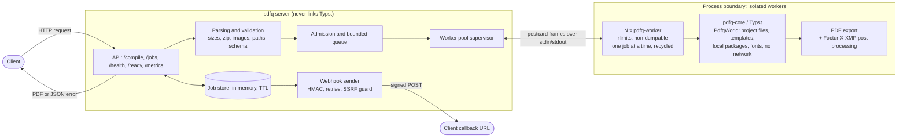
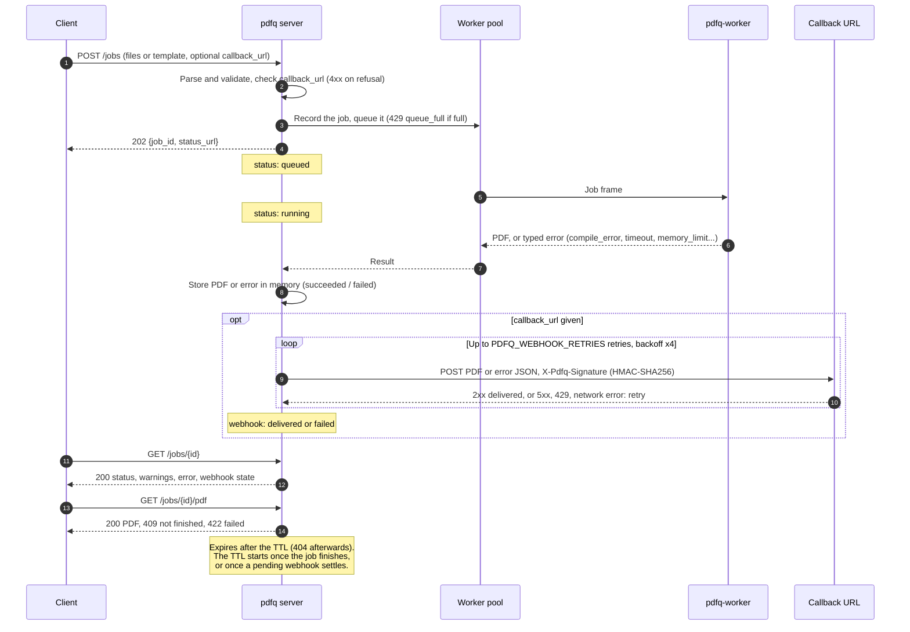

# PDFQ

Compile [Typst](https://typst.app) documents to PDF over HTTP, synchronously or asynchronously (webhook). No database: async jobs are kept in memory. Shipped as a Docker image, hardened against hostile documents. Think "Gotenberg for Typst".

- **Isolated:** every compilation runs in a separate worker process with memory, CPU, file and wall-clock limits. A hostile document gets a typed error (`timeout`, `memory_limit`, …), never a stuck or crashed server.
- **Templates or uploads:** send `.typ` files, a zip, or the name of a mounted template plus JSON data (optionally checked against a JSON Schema).
- **PDF/A, attachments, Factur-X:** embed files in the PDF and produce Factur-X / ZUGFeRD hybrid invoices (PDF/A-3b, XMP metadata), validated with veraPDF in CI.
- **Async jobs:** `POST /jobs`, then poll or receive a signed webhook (HMAC-SHA256, retries, SSRF protection).
- **Operable:** every limit has a default and a `PDFQ_*` variable, Prometheus `/metrics`, `/health` and `/ready`, distroless non-root image.

> Images are published on `ghcr.io/nseaseb/pdfq` (linux/amd64 and linux/arm64) for each release tag.
> The full HTTP contract is in [`docs/api-spec.md`](docs/api-spec.md).

## Quick start

```sh
docker run --rm -p 3000:3000 -v "$PWD/examples:/templates:ro" ghcr.io/nseaseb/pdfq:0.1.0-typst0.15.1
```

Tags: `<version>-typst<typst-version>` (pins the Typst version, recommended), `<version>`, and `latest` (newest stable release). To build the image yourself instead:

```sh
docker build -t pdfq .
docker run --rm -p 3000:3000 -v "$PWD/examples:/templates:ro" pdfq
```

Compile uploaded files (the part's filename is the path in the project):

```sh
echo '= Hello #sys.inputs.at("who", default: "you")' > main.typ
curl -F file=@main.typ -F input.who=world localhost:3000/compile -o hello.pdf
```

Compile a mounted template with JSON data:

```sh
curl localhost:3000/compile -H 'content-type: application/json' \
  -d "{\"template\": \"invoice\", \"data\": $(cat examples/invoice/data.json)}" -o invoice.pdf
```

Errors are JSON with a `kind` and, for compile errors, diagnostics with file, line and column:

```json
{ "error": { "kind": "compile_error", "message": "compilation failed",
  "diagnostics": [ { "severity": "error", "message": "unclosed delimiter",
                     "file": "main.typ", "line": 2, "column": 10, "hints": [] } ] } }
```

Document-caused failures (`compile_error`, `timeout`, `memory_limit`, `too_many_pages`, …) are `422`: they are deterministic, resending the same document gives the same error. Worth retrying later: `429` (`queue_full`), `500` (`worker_crashed`, `internal`), and an async job that failed with `queue_full` (resubmit it).

## Architecture

The HTTP server validates and queues requests; Typst only ever runs in separate, rlimited worker processes.



- `pdfq` parses and validates every request (sizes, zip contents, image headers, paths, template JSON Schema) before anything reaches a worker, and answers `429` when the queue is full.
- Each `pdfq-worker` handles one job at a time, exchanging length-prefixed postcard frames with the server over stdin/stdout, and is replaced after a crash, a timeout or `PDFQ_JOBS_PER_WORKER` jobs.
- `PdfqWorld` reads only the job's files, mounted templates, local packages and fonts: no network.
- Async jobs follow this lifecycle:



## Usage

### Data and inputs

`data` is a JSON document exposed as a string in `sys.inputs.data`; `input.<key>` fields are plain strings in `sys.inputs.<key>`.

```typ
#let data = json(bytes(sys.inputs.at("data", default: "{}")))
Invoice #data.number for #data.client.name
```

### Templates

Mount a directory at `/templates` (`PDFQ_TEMPLATE_DIR`):

```
/templates/invoice/
  main.typ        # entrypoint
  schema.json     # optional: JSON Schema checked against `data` before compiling
  logo.png        # files readable from main.typ
```

In template mode, `asset` parts are mounted under `/assets/` (e.g. a per-customer logo: `image("/assets/logo.png")`).

### Async jobs and webhooks

Webhooks are disabled until `PDFQ_WEBHOOK_SECRET` is set (`docker run -e PDFQ_WEBHOOK_SECRET=… pdfq`). Without `callback_url`, poll the job.

```sh
curl -F file=@main.typ -F callback_url=https://example.com/hook localhost:3000/jobs
# 202 {"job_id": "…", "status_url": "/jobs/…"}
curl localhost:3000/jobs/<id>        # status, warnings, error, webhook state
curl localhost:3000/jobs/<id>/pdf    # 200 PDF, 409 not finished, 422 failed
```

The PDF (or the error JSON) is POSTed with `X-Pdfq-Signature: sha256=<hex HMAC-SHA256(secret, "<X-Pdfq-Timestamp>.<body>")>`. Check it before trusting the body:

```python
import hashlib, hmac, time

def verify(secret: bytes, headers: dict, body: bytes, max_age: int = 300) -> bool:
    """Returns False (never raises) on a missing, stale or wrong signature."""
    headers = {k.lower(): v for k, v in headers.items()}
    ts, signature = headers.get("x-pdfq-timestamp", ""), headers.get("x-pdfq-signature", "")
    if not ts.isdigit() or abs(time.time() - int(ts)) > max_age:
        return False
    expected = "sha256=" + hmac.new(secret, ts.encode() + b"." + body, hashlib.sha256).hexdigest()
    return hmac.compare_digest(signature.encode(), expected.encode())
```

By default callbacks must be HTTPS and resolve to public addresses. A receiver on your machine or private network needs `PDFQ_WEBHOOK_ALLOW_HTTP=true` and `PDFQ_WEBHOOK_ALLOW_PRIVATE=true`; `PDFQ_WEBHOOK_ALLOWED_HOSTS` restricts callbacks to a list of hosts. Jobs live in memory: **a restart loses them**.

Client examples in Python, Node.js and Elixir (Livebook): [`examples/clients/`](examples/clients/) (the Python one includes a complete webhook receiver around this `verify()`).
An OpenAPI 3.1 description is in [`docs/openapi.yaml`](docs/openapi.yaml): import it into Postman, Insomnia or Bruno, or generate clients from it. A ready-made Bruno collection, runnable as a smoke test with `bru run`, is in [`examples/bruno/`](examples/bruno/).

### Attachments and Factur-X

```sh
# Any file, embedded as-is (PDF/A-3 allows attachments).
curl -F file=@main.typ -F attachment=@lines.csv -F pdf_standard=a-3b localhost:3000/compile -o out.pdf

# Factur-X: embeds factur-x.xml, implies PDF/A-3b, writes the Factur-X XMP metadata.
curl -F file=@main.typ -F facturx=@invoice.xml -F facturx_profile=en16931 \
  localhost:3000/compile -o invoice.pdf
```

PDFQ embeds the CII XML you provide; it does not generate it, nor validate it against the Factur-X schemas.

### Fonts and packages

- **Fonts:** a default set is embedded. Add more by mounting a directory at `/fonts`. Documents cannot upload fonts.
- **Packages:** documents can `#import "@preview/<name>:<version>"` only from packages present on the server, never downloaded at runtime. The image ships a small set listed in [`packages/packages.txt`](packages/packages.txt) (QR codes and number formatting by default, more commented out). To use others:
  - **without rebuilding**, extract them to `/packages/preview/<name>/<version>/` (dependencies included);
  - **in the image**, uncomment or add them in `packages/packages.txt` and `packages/smoke.typ`, then rebuild. The build checks hashes and dependencies and compiles every package.
  - `PDFQ_ALLOWED_PACKAGES` (e.g. `@preview/tiaoma:0.3.0`) restricts imports to a list.

## Configuration

Every setting has a default and can be set with an environment variable or the matching flag (`docker run --rm pdfq --help`), except `PDFQ_LOG` and `PDFQ_WEBHOOK_SECRET` (environment only, so the secret never shows in the process command line). Sizes accept `KiB`/`MiB`/`GiB`, durations `s`/`m`/`h`.

| Variable | Default | |
|---|---|---|
| `PDFQ_BIND` | `0.0.0.0:3000` | Listen address |
| `PDFQ_WORKERS` | CPU count | Worker processes |
| `PDFQ_JOBS_PER_WORKER` | `100` | Jobs before a worker is replaced |
| `PDFQ_QUEUE_SIZE` | `64` | Queued jobs before `429` |
| `PDFQ_WALL_TIMEOUT` / `PDFQ_CPU_TIMEOUT` | `30s` / `20s` | Per job |
| `PDFQ_MEMORY_LIMIT` | `512MiB` | Per job, above the worker baseline (enforced on Linux) |
| `PDFQ_TEMPLATE_DIR`, `PDFQ_FONT_PATHS`, `PDFQ_PACKAGE_PATHS` | image: `/templates`, `/fonts`, preloaded + `/packages` | |
| `PDFQ_LOG` | `info` | Log filter (`tracing` syntax) |

Input, output, job store and webhook limits are listed in the [API spec](docs/api-spec.md#limits).

## Security model

- The HTTP server never runs Typst. Each compilation goes to a `pdfq-worker` process started with hard rlimits: address space, CPU, open files (`PDFQ_WORKER_OPEN_FILES`, 64), file size 0 (files cannot grow), no core dumps. On Linux it also gets `no_new_privs`, is non-dumpable and is killed when the server dies. Before each job the worker lowers its own memory and CPU limits to the per-job budget.
- A job over its wall-clock time is killed with `SIGKILL` and its worker replaced; workers are also recycled after `PDFQ_JOBS_PER_WORKER` jobs.
- Documents only see their own files, mounted templates and installed packages: no network, no `..` or symlink escape, no other file on disk.
- Inputs are checked before compiling: sizes, file counts, zip bombs (real decompressed size), image dimensions from headers, page count, output size.
- Hostile documents (infinite loops, exponential recursion, memory bombs, path traversal, image bombs, …) live in [`tests/fixtures/hostile/`](tests/fixtures/hostile/) and run in CI.

Isolation relies on process rlimits, not on a sandbox. Harden the container as usual; the image works with:

```sh
docker run --read-only --cap-drop ALL --security-opt no-new-privileges --memory 2g \
  -e PDFQ_WORKERS=2 -e PDFQ_MEMORY_LIMIT=256MiB -e PDFQ_QUEUE_SIZE=8 \
  -e PDFQ_MAX_UPLOAD_SIZE=20MiB -e PDFQ_MAX_STORED_SIZE=256MiB -p 3000:3000 pdfq
```

Size the container memory for the sum of:

- workers: `PDFQ_WORKERS × (PDFQ_MEMORY_LIMIT + worker baseline)`;
- request bodies held at once: `(PDFQ_WORKERS + PDFQ_QUEUE_SIZE) × (PDFQ_MAX_UPLOAD_SIZE + PDFQ_MAX_DATA_SIZE)`;
- the async job store: `PDFQ_MAX_STORED_SIZE`.

Otherwise the kernel OOM killer acts before the per-job limits and the error is no longer typed (or the server itself is killed). Lower `PDFQ_QUEUE_SIZE`, `PDFQ_MAX_UPLOAD_SIZE` and `PDFQ_MAX_STORED_SIZE` for small containers. `PDFQ_WORKERS` defaults to the CPU count. Memory limits are only enforced on Linux.

### Threat model

Covered:

- Documents that try to exhaust CPU, memory, wall-clock time, pages or output size.
- Documents that try to read files outside their project, or reach the network, through Typst. The compiler only sees what `PdfqWorld` serves.
- Zip bombs and image bombs.
- Hostile webhook targets (SSRF guard: private addresses refused, no redirects, no proxy).
- On Linux, the server and workers are non-dumpable: a worker cannot read `/proc/<pid>/environ` or `/proc/<pid>/mem` of the server or of other workers, nor ptrace them. In the image, `pdfq` and `pdfq-worker` are execute-only (mode `0711`, owned by root), so the kernel starts them non-dumpable, with no window before `main`. `/proc/<pid>/cmdline` stays world-readable, which is why `PDFQ_WEBHOOK_SECRET` can only be set in the environment. Workers also start with an empty environment, so they do not inherit it.

Not covered:

- A memory-safety or logic bug in Typst or its dependencies that gives code execution in the worker. The worker runs as the same user as the server. Network and file confinement come from PDFQ's code, not from the kernel (no seccomp, no namespaces).
- A compromised worker runs as the same user, so it can still send signals to the server and other workers (stop or kill them): a denial of service, not a data leak.
- Outside the image, install `pdfq-worker` (and `pdfq`) with mode `0711`, owned by another user than the one running the service; otherwise a worker is dumpable between `execve` and its first instruction, and a sibling that opens its `/proc` files in that window keeps access. This relies on `fs.suid_dumpable` being `0` (the default) or `2`.
- A worker serves up to `PDFQ_JOBS_PER_WORKER` jobs (100 by default), so a compromised worker could see later documents. Set `PDFQ_JOBS_PER_WORKER=1` to start a fresh process per job, at a throughput cost.

Mitigation: run the hardened container shown above, without network access it does not need, and on its own (no other secrets or services in the same container). A seccomp filter in the worker is a possible future step.

## Observability

- `GET /health`: `200` while at least one worker is alive (`503` otherwise), with the PDFQ and Typst versions. Used by the image `HEALTHCHECK`.
- `GET /ready`: `200` when a worker is ready and the queue is not full.
- `GET /metrics`: Prometheus metrics (job outcomes and durations, workers, queue, rejections, webhooks). Not subject to admission control.

## Development

See [CONTRIBUTING.md](CONTRIBUTING.md) for the setup, the checks and a map of the code.

## Limitations

- Async jobs and their PDFs are kept in memory only.
- PDF output only (no PNG/SVG). No per-request fonts.
- One Typst version per image (`/health` reports it); image tags are meant to carry it, e.g. `pdfq:0.1.0-typst0.15.1`.
- Factur-X XML is embedded, not generated or schema-validated.

## License

Licensed under the [MIT license](LICENSE). Typst and the bundled packages and fonts keep their own licenses.
